---

## 👋 Hey, I'm Abraham

I'm a maker who got hooked on drones somewhere around 2019 and never really landed. Still exploring 

## 🔧 What I make

- 🚁 **Drones:**  multirotors, fixed-wing platforms and some random  projects 
- 🔌 **Electronics:** custom PCBs, embedded firmware and sensor integration
- 🧭 **Navigation:** GPS-denied navigation and localization 
- 📡 **FPV:** videos , well the  adrenaline part

## 🔭 Exploring right now

- Interesting random topics 
- LLMS ,home servers .. well  random interesting things ,
- In that urge to see things working  

## 🛩️ Flight Crew

Founder, member, fellow pilot @ [**Drone Racers Kerala**](https://github.com/droneracerskerala). 
## 📬 Say hi

